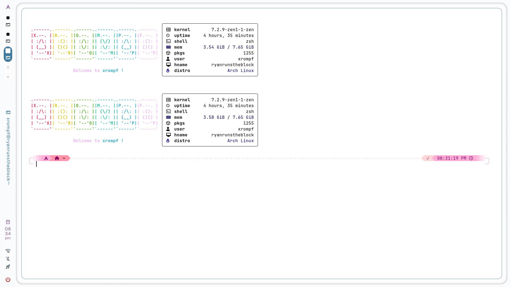

yes i do use linux-zen 7.2.9 kernel instead of cachyos v3 or base linux like any true sigma would ofc
- DISCLAMER: be carefull when using blur with your wallpaper on foot.ini config if it has a plain baground and high contrast (like my wallpaper) it could possibly cause burn-in on old oled monitors!
- idk follow me on tiktok @xrompf and give this repo a star if you like it 

what i reccomend (not my software and also support them by staring their project etc)
- the astrasuite ecosystem 
- caelestia sddm theme

## Installation wizard
(supports most package installers)
Installation wizard script:
```bash
curl -sSL https://raw.githubusercontent.com/xrompf/simple-terminal-rice/refs/heads/main/install.sh | bash
```
- Dependencies (installs with the wizard dont worry unless )
- foot 
- zsh 
- fastfetch 
- Oh My Zsh 
